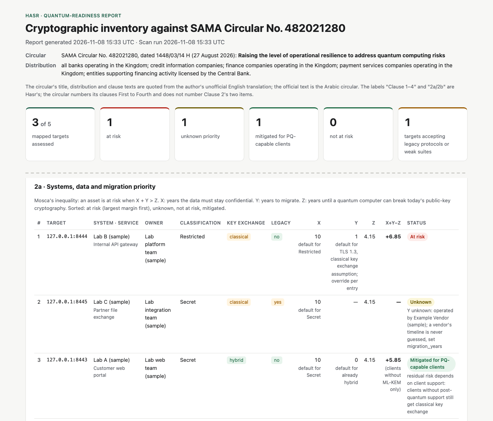

# Hasr

Hasr inventories the cryptography of TLS endpoints, from the network and from
the cloud provider's own records, and reports it against
**SAMA Circular No. 482021280** on quantum-computing risk. The name comes from
«حصر» (*hasr*), the word Clause 2 of the circular uses for inventorying
cryptographic assets.



*The first screen of one report, from the test lab with the sample mapping.*

## Why

Traffic protected today by RSA, Diffie-Hellman or elliptic-curve key exchange
can be recorded now and decrypted once a large enough quantum computer exists
("harvest now, decrypt later"). SAMA Circular No. 482021280 (27 August 2026)
requires financial institutions to ensure accurate and comprehensive procedures
for inventorying and classifying all their cryptographic assets by the end of
Q4 2026. An inventory built from interviews and spreadsheets cannot prove it is
complete, and it goes out of date as soon as a system changes.

## What Hasr does today

- `hasr scan` connects to each TLS endpoint you list and records the cryptography it accepts.
- `collectors/aws/collect.sh` reads an AWS account's load balancers, their TLS
  policies and certificates, read-only; `hasr cloud aws` converts what it
  collected into a provider-neutral file.
- `hasr report` joins a scan with a mapping file (systems, owners, data
  classification) and, optionally, cloud files, and writes an HTML report, with
  its JSON, organised by the circular's clauses.

| Clause | What Hasr provides today | What stays with the institution |
|---|---|---|
| **1** Enterprise risk assessment (due end of Q1 2027) | Technical input: key-exchange status, legacy findings and Mosca margin per endpoint | The assessment itself; operational, legal, regulatory, strategic and workforce risks; the action plans |
| **2a** Data, systems and services; sensitivity and migration priority (due end of Q4 2026) | TLS discovery; links to systems and owners from the mapping file; migration priority by Mosca's inequality | A complete, correct target list and mapping data |
| **2b** Crypto-agility, constraints, third parties | Evidence from the scan (TLS 1.3, hybrid key exchange) and the cloud records (a managed TLS policy, changeable in place); constraints and third parties from the mapping file | The crypto-agility assessment: Hasr's rating is not built yet |
| **2** Completeness and accuracy of the procedures | A completeness figure; lists of targets that need owner input, were mapped but not scanned, could not be assessed, or were found in the cloud but not in the target list; disagreements between the scan and the cloud records; the stated limits of the scanner and the collectors | Cryptography outside TLS endpoints |
| **3** Plans to reach the required crypto-agility | A recommended action for each finding, in priority order | The plans and initiatives |
| **4** Standing monitoring by committees | Repeatable scans; each scan's JSON can be kept as evidence | The committees' agenda and escalation. Tracking changes between scans is not built yet |

Reports quote an unofficial English translation of the circular; the official
text is the Arabic original.

## How it works

`hasr scan` runs seven ordinary handshakes per target, each with a different
offer: Go's default; hybrid key exchange only (X25519MLKEM768); classical groups
only; TLS 1.2 at most; TLS 1.1 only; TLS 1.0 only; and TLS 1.2 with only RSA key
transport, 3DES and RC4 suites. From the answers it sets two independent fields:
`key_exchange` (hybrid, classical or unknown) and `legacy` (yes, no or unknown).
A handshake that got no answer never counts as "not supported".

Each handshake first opens a TCP connection, then runs TLS on it, so a target
that never answers at the TCP level ("no TCP connection") is never confused
with one that refuses at the TLS level. A refusal is an alert. Some servers
refuse instead with a close_notify alert and no reason: AWS load balancers do
this for a version above their policy's maximum or when no cipher suite is in
common. Hasr counts that as a refusal and keeps the bytes the server sent as
evidence in the JSON. A connection closed without a single byte counts as a
refusal only if a retry gives the same and another handshake to the same
target succeeded.

`hasr report` ranks assets by Mosca's inequality, X + Y > Z: X is how long the
data must stay confidential, Y how long migration takes, and Z the time until the
quantum threat or a regulatory deadline. When Y is unknown (a vendor's timeline is
never guessed), X − Z is a lower bound: above 0, the asset is at risk whatever Y
is, and the report shows "≥" and asks for the value. Within a status, assets are
ordered by sensitivity, then legacy protocols, then third-party dependency, then
margin. The default policy sets Z to 31 December
2030 (the NIST IR 8547 deprecation date and the EU roadmap deadline for high-risk
use cases), with its source printed in the report. [DECISIONS.md](DECISIONS.md)
records every rule and the reason for it.

With cloud files, the report matches each scanned `host:port` to the cloud
records for the same hostname (or the end of its CNAME chain) and port. Where
the scan and a record disagree, the worse value counts and the disagreement is
listed under Clause 2. Provider rules, such as AWS's "policies with PQ in the
name offer hybrid key exchange", live in the provider's converter, each with
its documentation link; the report reads only the provider-neutral file.

## Quick start

Requirements: Go 1.21 or later (Go then fetches the 1.27.3 toolchain pinned in
`go.mod`) and, for the test lab, OpenSSL 3.5.6 or later.

```sh
go build -o hasr .
./testlab/start.sh        # three TLS test servers on 127.0.0.1:8443-8445
./hasr scan -table 127.0.0.1:8443 127.0.0.1:8444 127.0.0.1:8445
```

```
TARGET          KEX        LEGACY  VERSIONS     DEFAULT GETS            CERT KEYS    TRUSTED
127.0.0.1:8443  hybrid     no      1.2 1.3      TLS 1.3 X25519MLKEM768  ECDSA P-256  0/1
127.0.0.1:8444  classical  no      1.2 1.3      TLS 1.3 x25519          ECDSA P-256  0/1
127.0.0.1:8445  classical  yes     1.0 1.1 1.2  TLS 1.2 x25519          RSA 2048     0/1
```

A note and one detail block per target follow the table. Without `-table`,
`hasr scan` writes JSON. Then the report:

```sh
./hasr scan --targets testlab/mapping.csv > scan.json
./hasr report --scan scan.json --map testlab/mapping.csv   # writes hasr-report.html and hasr-report.json
./testlab/stop.sh
```

`testlab/mapping.csv` is fictional sample data. Two of its entries have no
server behind them, so the report shows the "not assessed" section and
`hasr scan` exits with status 1 (expected). `testlab/start.sh` uses the `openssl` on your
`PATH`; set `OPENSSL=/path/to/openssl` to use another.

**Printing.** The report has two print buttons. "Print summary" prints the first
screen, completeness and clause coverage (also what Ctrl/Cmd+P prints, and
the only print without JavaScript). "Print full report" opens every section first.
The report sets its own A4 margins and footer (scan date, page N of M), so turn
off "Headers and footers" in the browser's print dialog; otherwise the browser
adds the file path and print time.

## Cloud discovery (AWS)

Collect, convert, report. Hasr itself never handles cloud credentials:

```sh
AWS_PROFILE=hasr-readonly collectors/aws/collect.sh -o RAW_DIR --region eu-north-1
./hasr cloud aws --from RAW_DIR > aws.json
./hasr report --scan scan.json --map mapping.csv --cloud aws.json
```

The collector runs only read-only `aws` commands, refuses root credentials and
records every call with its exit status. Run it as an identity with
[`collectors/aws/iam-policy.json`](collectors/aws/iam-policy.json). `RAW_DIR` is
evidence: keep it with the report, and out of version control (it holds account
IDs and ARNs). Endpoints found in the account are listed, never scanned
automatically.

[`cloudlab/aws/`](cloudlab/aws/) is a Terraform demo: two load balancers that
differ only in their TLS policy. `up.sh` plans it with your current public IP,
you apply, `scan-demo.sh` scans it, `terraform destroy` removes it and
`check-clean.sh` confirms nothing is left. It costs under $2 a day while it
runs (about $1.63 in eu-north-1).

## Mapping and policy files

- **Targets:** written as `host:port` with a numeric port. Hosts are
  compared without case or a trailing dot, so `BANK.SA.:443` and `bank.sa:443`
  are the same target. IPv6 goes in brackets (`[2001:db8::1]:443`). On the
  command line, a target without a port means `:443`.
- **Mapping CSV:** one row per `host:port`, with the columns `target, system,
  service, owner, data_classification, data_shelf_life_years, migration_years,
  third_party, constraints`. `data_classification` must be one of the policy's
  levels. `data_shelf_life_years` (X) and `migration_years` (Y) override the
  defaults for that row. When `third_party` is not `in-house` and
  `migration_years` is empty, Y stays unknown: a vendor's timeline is never guessed.
- **Policy:** [`policy/default.json`](policy/default.json) holds the classification
  levels (the Saudi NDMO levels), the default X per level, the default Y per scan
  category (including a managed TLS policy found in the cloud), and Z as a
  date. Every value carries its source, which the report prints next to it.
  `--policy` points to another file.

## Responsible use

- Hasr sends only standard TLS handshakes. It does not exploit, fuzz or send application data.
- Scan only systems you own or are explicitly authorised to assess.
- The cloud collector only reads, and refuses root credentials; endpoints it
  finds are never scanned automatically.
- The test lab binds to 127.0.0.1 only. The AWS demo accepts connections only
  from the scanning machine and is scanned only while it exists.

## Limitations

- Network TLS endpoints, and AWS load balancers with their ACM certificates:
  Application Load Balancers (verified live); Network Load Balancers supported
  by the converter, tested on recorded responses only. Only the regions passed
  to the collector are read.
- AWS accounts from the new project-based experience are limited to the
  project's Region by an AWS-managed service control policy; collect only that
  Region there.
- Not tested: SSLv3, finite-field DHE, groups no probe offers, and the signature
  scheme the server uses in the handshake. Reports list these as the scanner's
  stated limits.
- 3DES and RC4 suites are offered, but a handshake using them has not yet been
  verified against a test server.
- One TLS client implementation: Go's `crypto/tls`.
- AWS: the API does not list a policy's key-exchange groups, so hybrid key
  exchange is read from the policy name, as AWS documents it. TLS from a load
  balancer to its targets, certificates stored in IAM, and services other than
  load balancers are not read.

## Status and roadmap

- **Built:** `hasr scan`, `hasr report`, and AWS cloud discovery (`collect.sh`,
  `hasr cloud aws`), with the report organised by the circular's clauses.
- **Planned:** crypto-agility rating, change tracking
  between scans, verification of 3DES and RC4 handshakes, a Markdown report, CI
  with govulncheck; more AWS services (CloudFront, API Gateway, KMS, Classic
  Load Balancers); other providers (Google Cloud, Azure, Cloudflare).
- **Later:** code scanning and other discovery layers.

## Development

```sh
go test ./...
GOTOOLCHAIN=go1.27.3 go install golang.org/x/vuln/cmd/govulncheck@latest
"$(go env GOPATH)/bin/govulncheck" ./...
```

govulncheck must be built with the project's Go version; an older build cannot
read the code. The tests run `collect.sh` against a fake `aws` command
(`collectors/aws/testdata/aws`) and never contact AWS.
[DECISIONS.md](DECISIONS.md) records every design decision, with its date and
reason.

## License

No license yet; all rights reserved.
